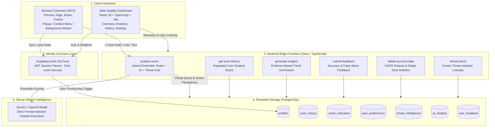

# ScamShield — System Architecture & Data Flow

---

## Component Responsibilities

| Component | Responsibility | Privacy & Security Boundary |
|---|---|---|
| **Extension (`extension/`)** | Zero-latency local auditing, URL/Text input, tab inspection, context menus, offline engine fallback | Minimum permissions (`activeTab`, `storage`, `contextMenus`). Never transmits credentials or unconsented data. |
| **Edge Functions (`supabase/functions/`)** | Hybrid score calculation, threat intel correlation, bounded AI calls with prompt injection defenses | Stateless serverless execution. Never exposes privileged keys to client devices. |
| **Database (`supabase/migrations/`)** | Profiles, Scans, Indicators, Preferences, Insights | PostgreSQL with strict Row Level Security (RLS) on all user tables. |
| **Dashboard (`dashboard/`)** | Executive risk overview, trend visualization, export/deletion controls | Authenticated user session scoping via Supabase Auth JWT. |
